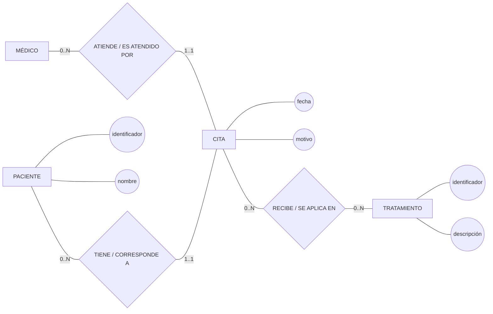
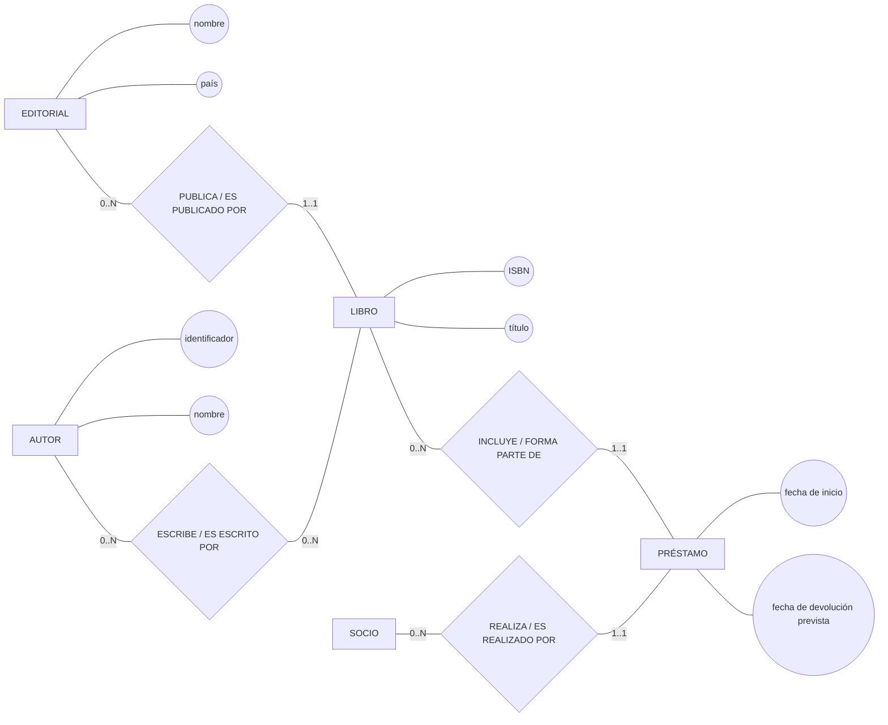
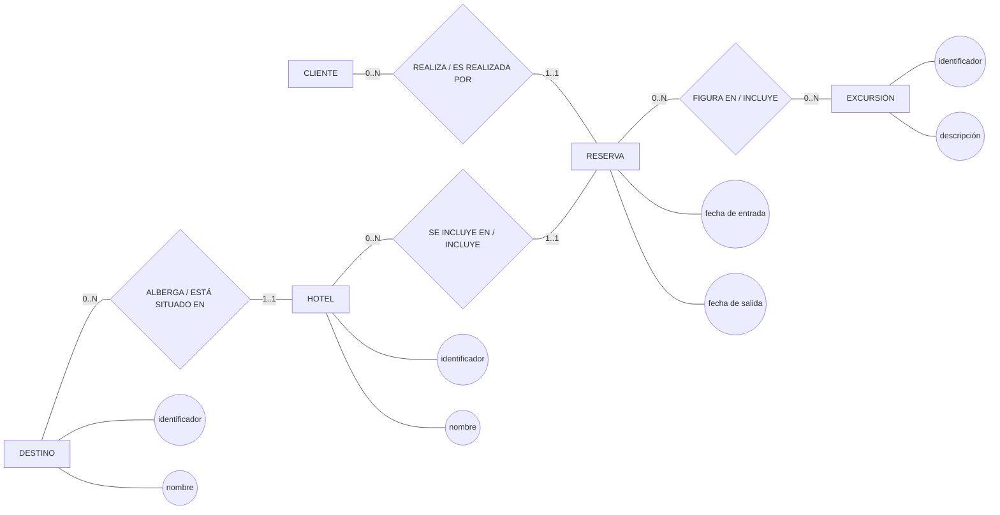
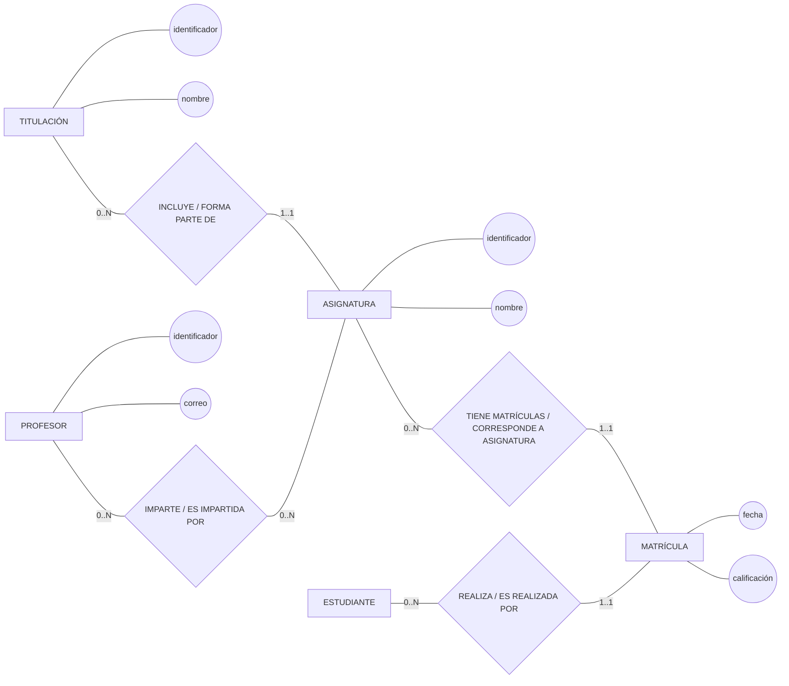
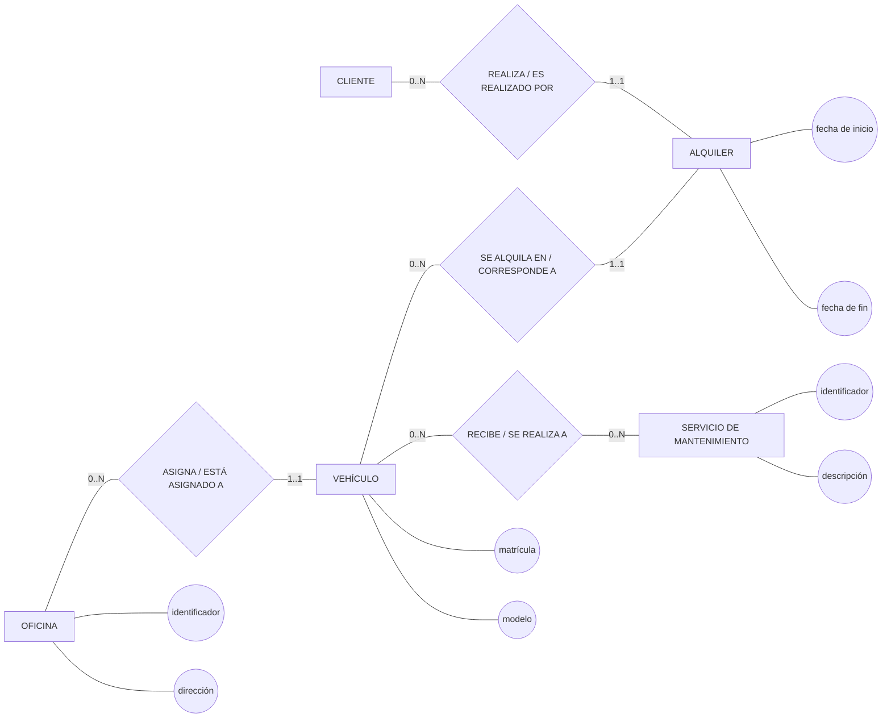
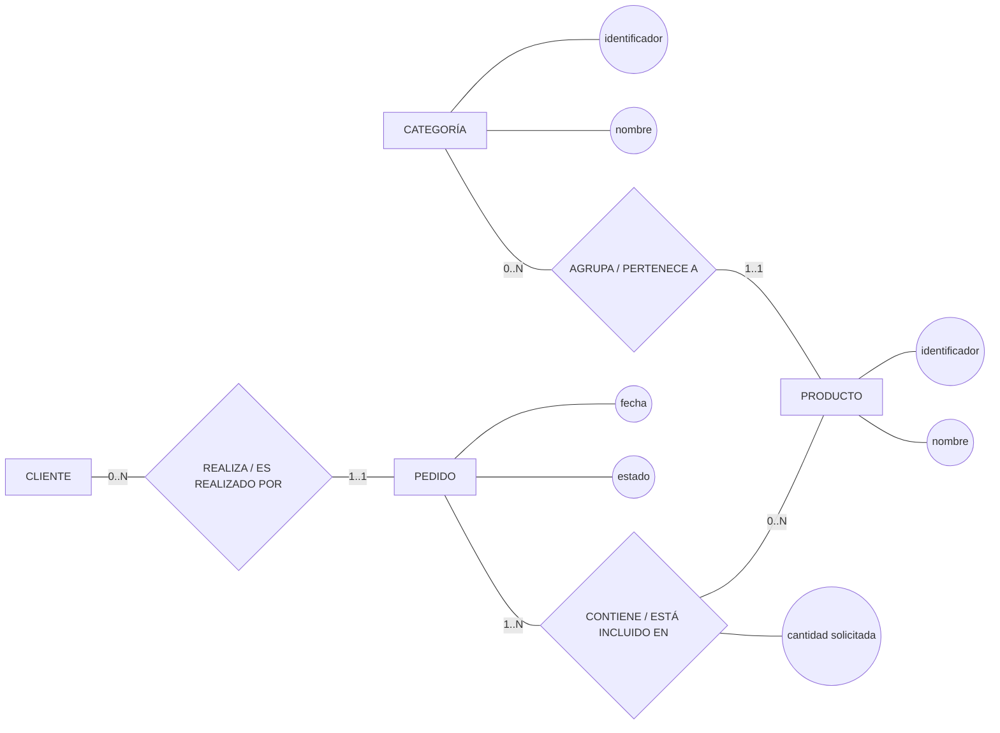
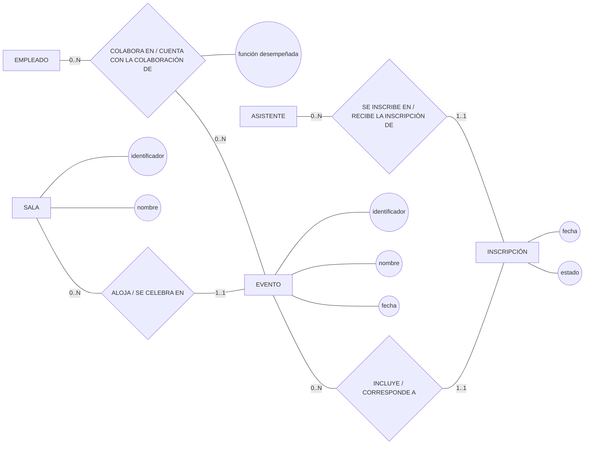
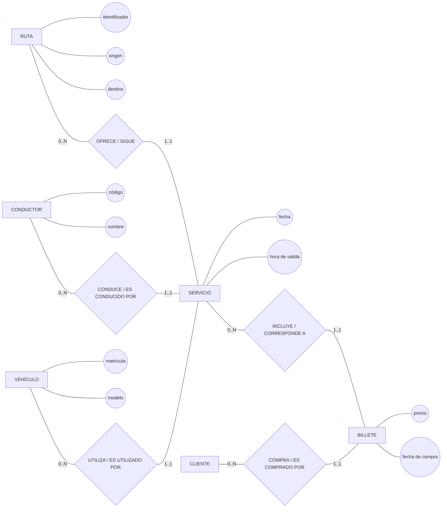
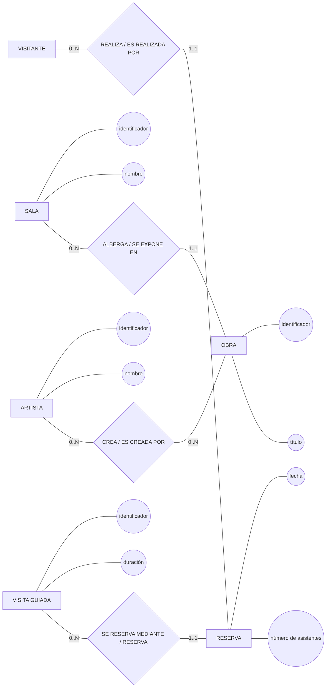
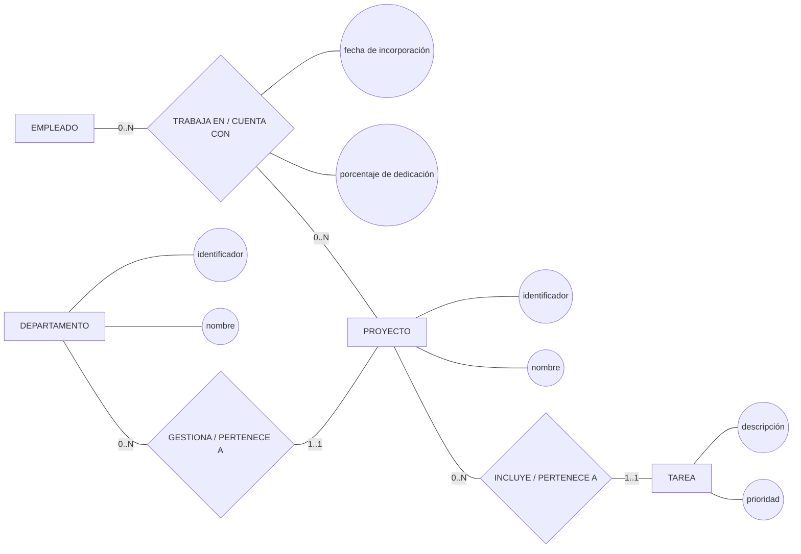

# Variante v1 — Clínica

## Entidades

PACIENTE, CITA, MÉDICO, TRATAMIENTO

## Matriz de relaciones

| Relación                 | Entidad 1 | Cardinalidad | Participación | Entidad 2   | Cardinalidad | Participación |
| --------------------------- | ----------- | -------------- | ---------------- | ------------- | -------------- | ---------------- |
| TIENE / CORRESPONDE A     | PACIENTE  | (0,N)        | Opcional       | CITA        | (1,1)        | Obligatoria    |
| ATIENDE / ES ATENDIDO POR | MÉDICO   | (0,N)        | Opcional       | CITA        | (1,1)        | Obligatoria    |
| RECIBE / SE APLICA EN     | CITA      | (0,N)        | Opcional       | TRATAMIENTO | (0,N)        | Opcional       |

## Mermaid

# Variante v2 — Biblioteca

## Entidades

LIBRO, EDITORIAL, AUTOR, SOCIO, PRÉSTAMO

## Matriz de relaciones

| Relación                  | Entidad 1 | Cardinalidad | Participación | Entidad 2 | Cardinalidad | Participación |
| ---------------------------- | ----------- | -------------- | ---------------- | ----------- | -------------- | ---------------- |
| PUBLICA / ES PUBLICADO POR | EDITORIAL | (0,N)        | Opcional       | LIBRO     | (1,1)        | Obligatoria    |
| ESCRIBE / ES ESCRITO POR   | AUTOR     | (0,N)        | Opcional       | LIBRO     | (0,N)        | Opcional       |
| REALIZA / ES REALIZADO POR | SOCIO     | (0,N)        | Opcional       | PRÉSTAMO | (1,1)        | Obligatoria    |
| FIGURA EN / INCLUYE        | LIBRO     | (0,N)        | Opcional       | PRÉSTAMO | (1,1)        | Obligatoria    |

## Mermaid

---

# Variante v3 — Agencia de viajes

## Entidades

DESTINO, HOTEL, CLIENTE, RESERVA, EXCURSIÓN

## Matriz de relaciones

| Relación                  | Entidad 1 | Cardinalidad | Participación | Entidad 2  | Cardinalidad | Participación |
| ---------------------------- | ----------- | -------------- | ---------------- | ------------ | -------------- | ---------------- |
| ALBERGA / ESTÁ SITUADO EN | DESTINO   | (0,N)        | Opcional       | HOTEL      | (1,1)        | Obligatoria    |
| REALIZA / ES REALIZADA POR | CLIENTE   | (0,N)        | Opcional       | RESERVA    | (1,1)        | Obligatoria    |
| SE INCLUYE EN / INCLUYE    | HOTEL     | (0,N)        | Opcional       | RESERVA    | (1,1)        | Obligatoria    |
| INCLUYE / FORMA PARTE DE   | RESERVA   | (0,N)        | Opcional       | EXCURSIÓN | (0,N)        | Opcional       |

## Mermaid

# Variante v4 — Universidad

## Entidades

TITULACIÓN, ASIGNATURA, PROFESOR, ESTUDIANTE, MATRÍCULA

## Matriz de relaciones

| Relación                                    | Entidad 1   | Cardinalidad | Participación | Entidad 2  | Cardinalidad | Participación |
| ---------------------------------------------- | ------------- | -------------- | ---------------- | ------------ | -------------- | ---------------- |
| INCLUYE / FORMA PARTE DE                     | TITULACIÓN | (0,N)        | Opcional       | ASIGNATURA | (1,1)        | Obligatoria    |
| IMPARTE / ES IMPARTIDA POR                   | PROFESOR    | (0,N)        | Opcional       | ASIGNATURA | (0,N)        | Opcional       |
| REALIZA / ES REALIZADA POR                   | ESTUDIANTE  | (0,N)        | Opcional       | MATRÍCULA | (1,1)        | Obligatoria    |
| TIENE MATRÍCULAS / CORRESPONDE A ASIGNATURA | ASIGNATURA  | (0,N)        | Opcional       | MATRÍCULA | (1,1)        | Obligatoria    |

## Mermaid

# Variante v5 — Empresa de alquiler

## Entidades

VEHÍCULO, OFICINA, CLIENTE, ALQUILER, SERVICIO DE MANTENIMIENTO

## Matriz de relaciones

| Relación                     | Entidad 1 | Cardinalidad | Participación | Entidad 2                 | Cardinalidad | Participación |
| ------------------------------- | ----------- | -------------- | ---------------- | --------------------------- | -------------- | ---------------- |
| ASIGNA / ESTÁ ASIGNADO A     | OFICINA   | (0,N)        | Opcional       | VEHÍCULO                 | (1,1)        | Obligatoria    |
| REALIZA / ES REALIZADO POR    | CLIENTE   | (0,N)        | Opcional       | ALQUILER                  | (1,1)        | Obligatoria    |
| SE ALQUILA EN / CORRESPONDE A | VEHÍCULO | (0,N)        | Opcional       | ALQUILER                  | (1,1)        | Obligatoria    |
| RECIBE / SE REALIZA A         | VEHÍCULO | (0,N)        | Opcional       | SERVICIO DE MANTENIMIENTO | (0,N)        | Opcional       |

## Mermaid

# Variante v6 — Tienda en línea

## Entidades

CATEGORÍA, PRODUCTO, CLIENTE, PEDIDO

## Matriz de relaciones

| Relación                    | Entidad 1  | Cardinalidad | Participación | Entidad 2 | Cardinalidad | Participación |
| ------------------------------ | ------------ | -------------- | ---------------- | ----------- | -------------- | ---------------- |
| AGRUPA / PERTENECE A         | CATEGORÍA | (0,N)        | Opcional       | PRODUCTO  | (1,1)        | Obligatoria    |
| REALIZA / ES REALIZADO POR   | CLIENTE    | (0,N)        | Opcional       | PEDIDO    | (1,1)        | Obligatoria    |
| CONTIENE / ESTÁ INCLUIDO EN | PEDIDO     | (1,N)        | Obligatoria    | PRODUCTO  | (0,N)        | Opcional       |

## Mermaid

# Variante v7 — Organización de eventos

## Entidades

EVENTO, SALA, EMPLEADO, ASISTENTE, INSCRIPCIÓN

## Matriz de relaciones

| Relación                                    | Entidad 1 | Cardinalidad | Participación | Entidad 2    | Cardinalidad | Participación |
| ---------------------------------------------- | ----------- | -------------- | ---------------- | -------------- | -------------- | ---------------- |
| ALOJA / SE CELEBRA EN                        | SALA      | (0,N)        | Opcional       | EVENTO       | (1,1)        | Obligatoria    |
| COLABORA EN / CUENTA CON LA COLABORACIÓN DE | EMPLEADO  | (0,N)        | Opcional       | EVENTO       | (0,N)        | Opcional       |
| SE INSCRIBE EN / RECIBE LA INSCRIPCIÓN DE   | ASISTENTE | (0,N)        | Opcional       | INSCRIPCIÓN | (1,1)        | Obligatoria    |
| INCLUYE / CORRESPONDE A                      | EVENTO    | (0,N)        | Opcional       | INSCRIPCIÓN | (1,1)        | Obligatoria    |

## Mermaid

# Variante v8 — Empresa de transporte

## Entidades

RUTA, SERVICIO, CONDUCTOR, VEHÍCULO, CLIENTE, BILLETE

## Matriz de relaciones

| Relación                  | Entidad 1 | Cardinalidad | Participación | Entidad 2 | Cardinalidad | Participación |
| ---------------------------- | ----------- | -------------- | ---------------- | ----------- | -------------- | ---------------- |
| OFRECE / SIGUE             | RUTA      | (0,N)        | Opcional       | SERVICIO  | (1,1)        | Obligatoria    |
| CONDUCE / ES CONDUCIDO POR | CONDUCTOR | (0,N)        | Opcional       | SERVICIO  | (1,1)        | Obligatoria    |
| UTILIZA / ES UTILIZADO POR | VEHÍCULO | (0,N)        | Opcional       | SERVICIO  | (1,1)        | Obligatoria    |
| COMPRA / ES COMPRADO POR   | CLIENTE   | (0,N)        | Opcional       | BILLETE   | (1,1)        | Obligatoria    |
| INCLUYE / CORRESPONDE A    | SERVICIO  | (0,N)        | Opcional       | BILLETE   | (1,1)        | Obligatoria    |

## Mermaid

# Variante v9 — Museo

## Entidades

OBRA, SALA, ARTISTA, VISITANTE, RESERVA, VISITA GUIADA

## Matriz de relaciones

| Relación                     | Entidad 1     | Cardinalidad | Participación | Entidad 2 | Cardinalidad | Participación |
| ------------------------------- | --------------- | -------------- | ---------------- | ----------- | -------------- | ---------------- |
| ALBERGA / SE EXPONE EN        | SALA          | (0,N)        | Opcional       | OBRA      | (1,1)        | Obligatoria    |
| CREA / ES CREADA POR          | ARTISTA       | (0,N)        | Opcional       | OBRA      | (0,N)        | Opcional       |
| REALIZA / ES REALIZADA POR    | VISITANTE     | (0,N)        | Opcional       | RESERVA   | (1,1)        | Obligatoria    |
| SE RESERVA MEDIANTE / RESERVA | VISITA GUIADA | (0,N)        | Opcional       | RESERVA   | (1,1)        | Obligatoria    |

## Mermaid

# Variante v10 — Empresa de desarrollo

## Entidades

DEPARTAMENTO, PROYECTO, EMPLEADO, TAREA

## Matriz de relaciones

| Relación               | Entidad 1    | Cardinalidad | Participación | Entidad 2 | Cardinalidad | Participación |
| ------------------------- | -------------- | -------------- | ---------------- | ----------- | -------------- | ---------------- |
| GESTIONA / PERTENECE A  | DEPARTAMENTO | (0,N)        | Opcional       | PROYECTO  | (1,1)        | Obligatoria    |
| TRABAJA EN / CUENTA CON | EMPLEADO     | (0,N)        | Opcional       | PROYECTO  | (0,N)        | Opcional       |
| INCLUYE / PERTENECE A   | PROYECTO     | (0,N)        | Opcional       | TAREA     | (1,1)        | Obligatoria    |

## Mermaid

