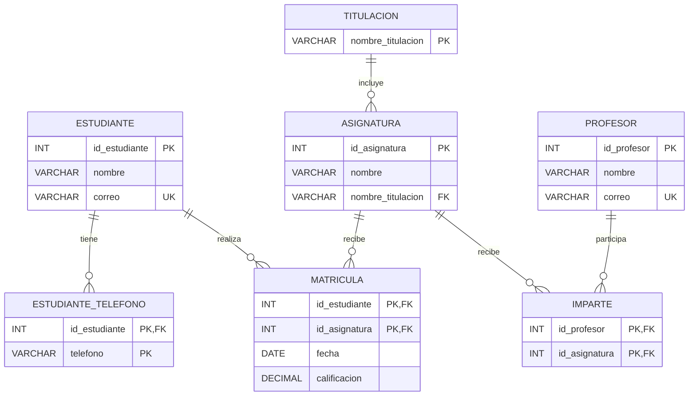
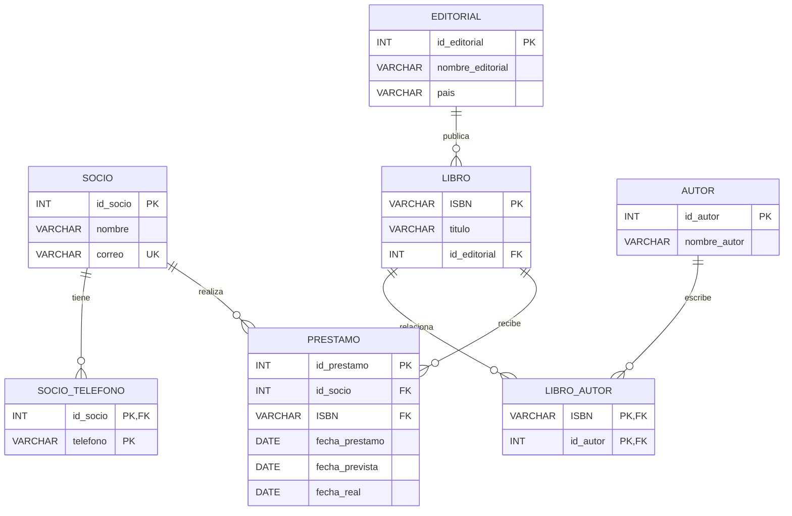
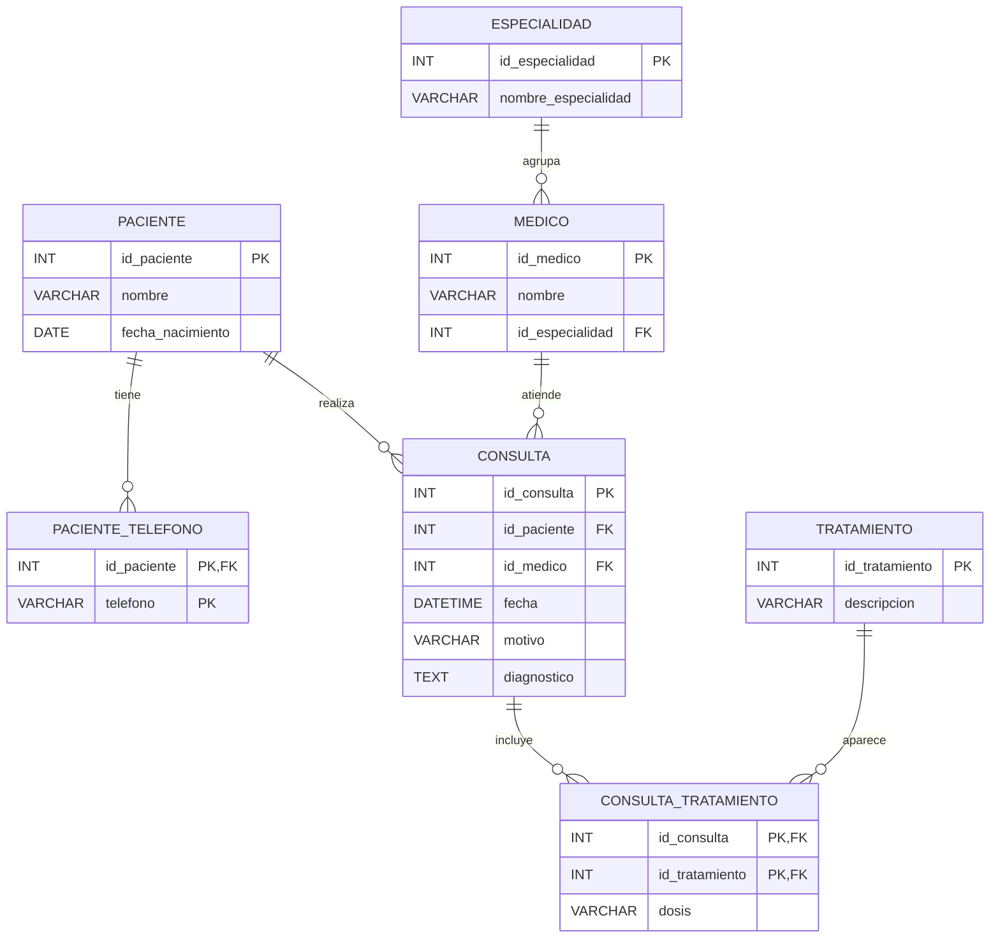
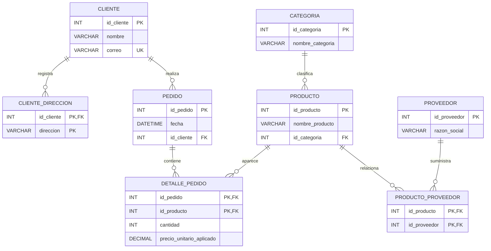
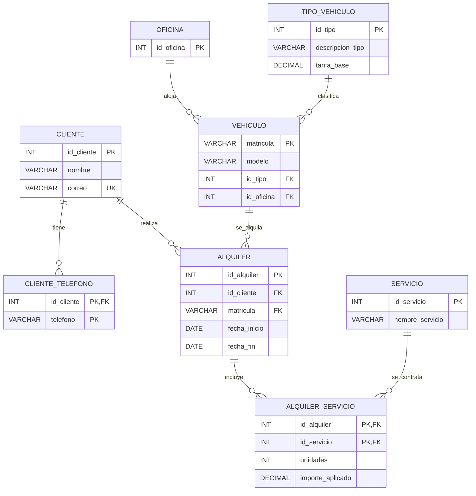
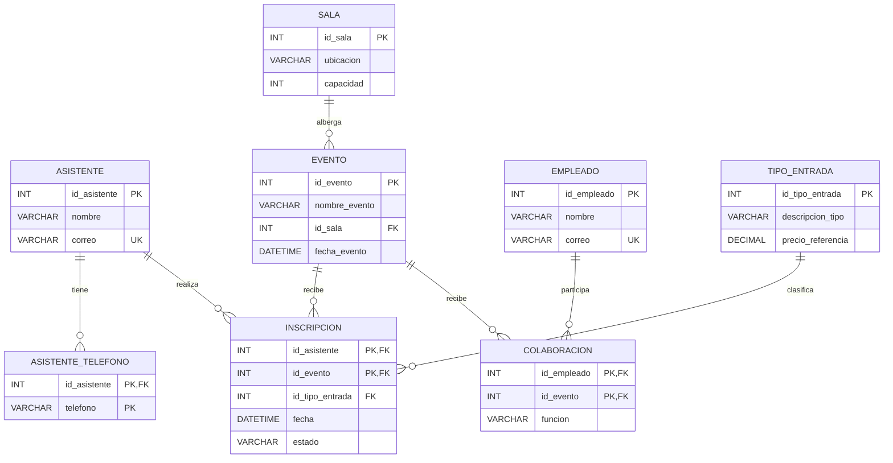
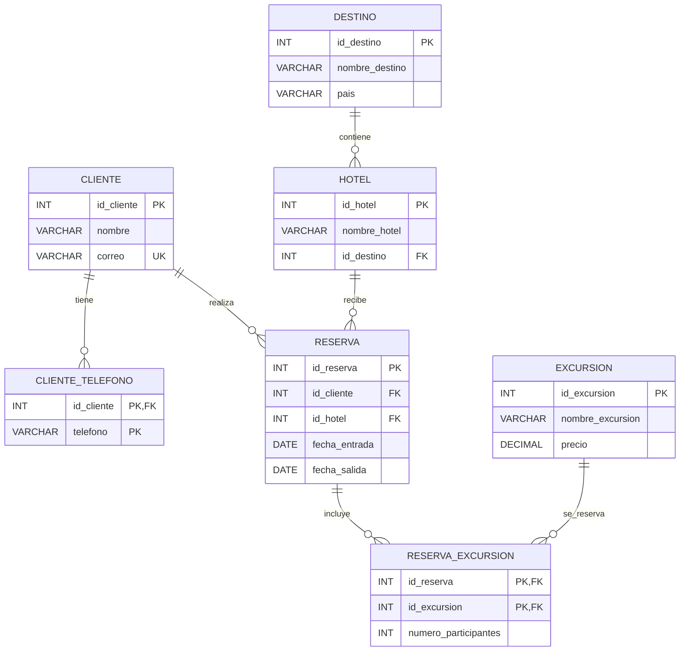
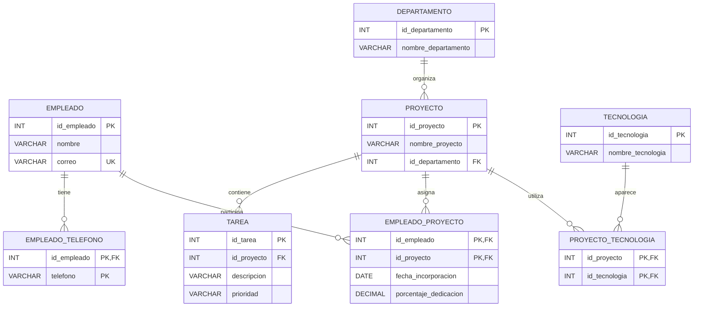
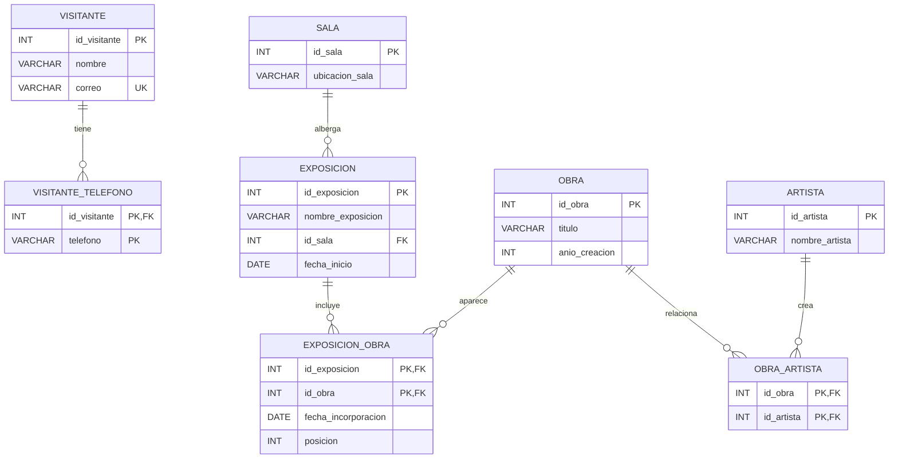
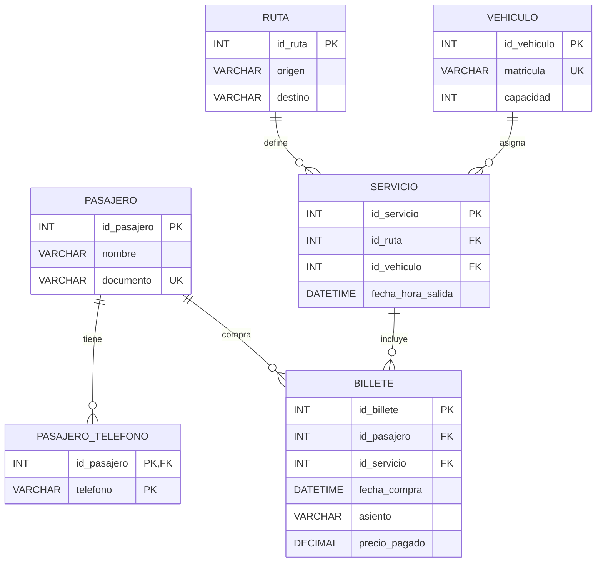

# V1 - UNIVERSIDAD

## Modelo relacional inicial

### ESTUDIANTE

| Atributo       | Tipo de dato | Restricciones    |
| ---------------- | -------------- | ------------------ |
| id\_estudiante | INT          | PK, NOT NULL     |
| nombre         | VARCHAR(100) | NOT NULL         |
| correo         | VARCHAR(150) | UNIQUE, NOT NULL |

### ESTUDIANTE\_TELEFONO

| Atributo       | Tipo de dato | Restricciones                                  |
| ---------------- | -------------- | ------------------------------------------------ |
| id\_estudiante | INT          | PK, FK -> ESTUDIANTE(id\_estudiante), NOT NULL |
| telefono       | VARCHAR(20)  | PK, NOT NULL                                   |

### TITULACION

| Atributo           | Tipo de dato | Restricciones |
| -------------------- | -------------- | --------------- |
| nombre\_titulacion | VARCHAR(100) | PK, NOT NULL  |

### ASIGNATURA

| Atributo           | Tipo de dato | Restricciones                                  |
| -------------------- | -------------- | ------------------------------------------------ |
| id\_asignatura     | INT          | PK, NOT NULL                                   |
| nombre             | VARCHAR(100) | NOT NULL                                       |
| nombre\_titulacion | VARCHAR(100) | FK -> TITULACION(nombre\_titulacion), NOT NULL |

### PROFESOR

| Atributo     | Tipo de dato | Restricciones    |
| -------------- | -------------- | ------------------ |
| id\_profesor | INT          | PK, NOT NULL     |
| nombre       | VARCHAR(100) | NOT NULL         |
| correo       | VARCHAR(150) | UNIQUE, NOT NULL |

> La clave compuesta supone una única matrícula por estudiante y asignatura. Si se permiten repeticiones en distintos cursos académicos, la clave debe incorporar ese contexto o un identificador de matrícula.

### MATRICULA

| Atributo       | Tipo de dato | Restricciones                                  |
| ---------------- | -------------- | ------------------------------------------------ |
| id\_estudiante | INT          | PK, FK -> ESTUDIANTE(id\_estudiante), NOT NULL |
| id\_asignatura | INT          | PK, FK -> ASIGNATURA(id\_asignatura), NOT NULL |
| fecha          | DATE         | NOT NULL                                       |
| calificacion   | DECIMAL(4,2) | NULL                                           |

### IMPARTE

| Atributo       | Tipo de dato | Restricciones                                  |
| ---------------- | -------------- | ------------------------------------------------ |
| id\_profesor   | INT          | PK, FK -> PROFESOR(id\_profesor), NOT NULL     |
| id\_asignatura | INT          | PK, FK -> ASIGNATURA(id\_asignatura), NOT NULL |

## Primera Forma Normal (1FN)

### Descomposición de ESTUDIANTE

### ESTUDIANTE

| Atributo       | Tipo de dato | Restricciones    |
| ---------------- | -------------- | ------------------ |
| id\_estudiante | INT          | PK, NOT NULL     |
| nombre         | VARCHAR(100) | NOT NULL         |
| correo         | VARCHAR(150) | UNIQUE, NOT NULL |

### ESTUDIANTE\_TELEFONO

| Atributo       | Tipo de dato | Restricciones                                  |
| ---------------- | -------------- | ------------------------------------------------ |
| id\_estudiante | INT          | PK, FK -> ESTUDIANTE(id\_estudiante), NOT NULL |
| telefono       | VARCHAR(20)  | PK, NOT NULL                                   |

## Segunda Forma Normal (2FN)

### MATRICULA

| Atributo       | Tipo de dato | Restricciones                                  |
| ---------------- | -------------- | ------------------------------------------------ |
| id\_estudiante | INT          | PK, FK -> ESTUDIANTE(id\_estudiante), NOT NULL |
| id\_asignatura | INT          | PK, FK -> ASIGNATURA(id\_asignatura), NOT NULL |
| fecha          | DATE         | NOT NULL                                       |
| calificacion   | DECIMAL(4,2) | NULL                                           |

## Tercera Forma Normal (3FN)

### ASIGNATURA

| Atributo           | Tipo de dato | Restricciones                                  |
| -------------------- | -------------- | ------------------------------------------------ |
| id\_asignatura     | INT          | PK, NOT NULL                                   |
| nombre             | VARCHAR(100) | NOT NULL                                       |
| nombre\_titulacion | VARCHAR(100) | FK -> TITULACION(nombre\_titulacion), NOT NULL |

### TITULACION

| Atributo           | Tipo de dato | Restricciones |
| -------------------- | -------------- | --------------- |
| nombre\_titulacion | VARCHAR(100) | PK, NOT NULL  |

## Diagrama relacional final

# V2 - BIBLIOTECA

## Modelo relacional inicial

### SOCIO

| Atributo  | Tipo de dato | Restricciones    |
| ----------- | -------------- | ------------------ |
| id\_socio | INT          | PK, NOT NULL     |
| nombre    | VARCHAR(100) | NOT NULL         |
| correo    | VARCHAR(150) | UNIQUE, NOT NULL |

### SOCIO\_TELEFONO

| Atributo  | Tipo de dato | Restricciones                        |
| ----------- | -------------- | -------------------------------------- |
| id\_socio | INT          | PK, FK -> SOCIO(id\_socio), NOT NULL |
| telefono  | VARCHAR(20)  | PK, NOT NULL                         |

### EDITORIAL

| Atributo          | Tipo de dato | Restricciones |
| ------------------- | -------------- | --------------- |
| id\_editorial     | INT          | PK, NOT NULL  |
| nombre\_editorial | VARCHAR(150) | NOT NULL      |
| pais              | VARCHAR(100) | NOT NULL      |

### LIBRO

| Atributo      | Tipo de dato | Restricciones                            |
| --------------- | -------------- | ------------------------------------------ |
| ISBN          | VARCHAR(20)  | PK, NOT NULL                             |
| titulo        | VARCHAR(200) | NOT NULL                                 |
| id\_editorial | INT          | FK -> EDITORIAL(id\_editorial), NOT NULL |

### AUTOR

| Atributo      | Tipo de dato | Restricciones |
| --------------- | -------------- | --------------- |
| id\_autor     | INT          | PK, NOT NULL  |
| nombre\_autor | VARCHAR(150) | NOT NULL      |

### LIBRO\_AUTOR

| Atributo  | Tipo de dato | Restricciones                        |
| ----------- | -------------- | -------------------------------------- |
| ISBN      | VARCHAR(20)  | PK, FK -> LIBRO(ISBN), NOT NULL      |
| id\_autor | INT          | PK, FK -> AUTOR(id\_autor), NOT NULL |

### PRESTAMO

| Atributo        | Tipo de dato | Restricciones                    |
| ----------------- | -------------- | ---------------------------------- |
| id\_prestamo    | INT          | PK, NOT NULL                     |
| id\_socio       | INT          | FK -> SOCIO(id\_socio), NOT NULL |
| ISBN            | VARCHAR(20)  | FK -> LIBRO(ISBN), NOT NULL      |
| fecha\_prestamo | DATE         | NOT NULL                         |
| fecha\_prevista | DATE         | NOT NULL                         |
| fecha\_real     | DATE         | NULL                             |

## Primera Forma Normal (1FN)

### SOCIO

| Atributo  | Tipo de dato | Restricciones    |
| ----------- | -------------- | ------------------ |
| id\_socio | INT          | PK, NOT NULL     |
| nombre    | VARCHAR(100) | NOT NULL         |
| correo    | VARCHAR(150) | UNIQUE, NOT NULL |

### SOCIO\_TELEFONO

| Atributo  | Tipo de dato | Restricciones                        |
| ----------- | -------------- | -------------------------------------- |
| id\_socio | INT          | PK, FK -> SOCIO(id\_socio), NOT NULL |
| telefono  | VARCHAR(20)  | PK, NOT NULL                         |

## Segunda Forma Normal (2FN)

### LIBRO\_AUTOR

| Atributo  | Tipo de dato | Restricciones                        |
| ----------- | -------------- | -------------------------------------- |
| ISBN      | VARCHAR(20)  | PK, FK -> LIBRO(ISBN), NOT NULL      |
| id\_autor | INT          | PK, FK -> AUTOR(id\_autor), NOT NULL |

## Tercera Forma Normal (3FN)

### LIBRO

| Atributo      | Tipo de dato | Restricciones                            |
| --------------- | -------------- | ------------------------------------------ |
| ISBN          | VARCHAR(20)  | PK, NOT NULL                             |
| titulo        | VARCHAR(200) | NOT NULL                                 |
| id\_editorial | INT          | FK -> EDITORIAL(id\_editorial), NOT NULL |

### EDITORIAL

| Atributo          | Tipo de dato | Restricciones |
| ------------------- | -------------- | --------------- |
| id\_editorial     | INT          | PK, NOT NULL  |
| nombre\_editorial | VARCHAR(150) | NOT NULL      |
| pais              | VARCHAR(100) | NOT NULL      |

## Diagrama relacional final

# V3 - CLINICA

## Modelo relacional inicial

### PACIENTE

| Atributo          | Tipo de dato | Restricciones |
| ------------------- | -------------- | --------------- |
| id\_paciente      | INT          | PK, NOT NULL  |
| nombre            | VARCHAR(100) | NOT NULL      |
| fecha\_nacimiento | DATE         | NOT NULL      |

### PACIENTE\_TELEFONO

| Atributo     | Tipo de dato | Restricciones                              |
| -------------- | -------------- | -------------------------------------------- |
| id\_paciente | INT          | PK, FK -> PACIENTE(id\_paciente), NOT NULL |
| telefono     | VARCHAR(20)  | PK, NOT NULL                               |

### ESPECIALIDAD

| Atributo             | Tipo de dato | Restricciones |
| ---------------------- | -------------- | --------------- |
| id\_especialidad     | INT          | PK, NOT NULL  |
| nombre\_especialidad | VARCHAR(100) | NOT NULL      |

### MEDICO

| Atributo         | Tipo de dato | Restricciones                                  |
| ------------------ | -------------- | ------------------------------------------------ |
| id\_medico       | INT          | PK, NOT NULL                                   |
| nombre           | VARCHAR(100) | NOT NULL                                       |
| id\_especialidad | INT          | FK -> ESPECIALIDAD(id\_especialidad), NOT NULL |

### CONSULTA

| Atributo     | Tipo de dato | Restricciones                          |
| -------------- | -------------- | ---------------------------------------- |
| id\_consulta | INT          | PK, NOT NULL                           |
| id\_paciente | INT          | FK -> PACIENTE(id\_paciente), NOT NULL |
| id\_medico   | INT          | FK -> MEDICO(id\_medico), NOT NULL     |
| fecha        | DATETIME     | NOT NULL                               |
| motivo       | VARCHAR(250) | NOT NULL                               |
| diagnostico  | TEXT         | NULL                                   |

### TRATAMIENTO

| Atributo        | Tipo de dato | Restricciones |
| ----------------- | -------------- | --------------- |
| id\_tratamiento | INT          | PK, NOT NULL  |
| descripcion     | VARCHAR(250) | NOT NULL      |

### CONSULTA\_TRATAMIENTO

| Atributo        | Tipo de dato | Restricciones                                    |
| ----------------- | -------------- | -------------------------------------------------- |
| id\_consulta    | INT          | PK, FK -> CONSULTA(id\_consulta), NOT NULL       |
| id\_tratamiento | INT          | PK, FK -> TRATAMIENTO(id\_tratamiento), NOT NULL |
| dosis           | VARCHAR(100) | NOT NULL                                         |

## Primera Forma Normal (1FN)

### PACIENTE

| Atributo          | Tipo de dato | Restricciones |
| ------------------- | -------------- | --------------- |
| id\_paciente      | INT          | PK, NOT NULL  |
| nombre            | VARCHAR(100) | NOT NULL      |
| fecha\_nacimiento | DATE         | NOT NULL      |

### PACIENTE\_TELEFONO

| Atributo     | Tipo de dato | Restricciones                              |
| -------------- | -------------- | -------------------------------------------- |
| id\_paciente | INT          | PK, FK -> PACIENTE(id\_paciente), NOT NULL |
| telefono     | VARCHAR(20)  | PK, NOT NULL                               |

## Segunda Forma Normal (2FN)

### CONSULTA\_TRATAMIENTO

| Atributo        | Tipo de dato | Restricciones                                    |
| ----------------- | -------------- | -------------------------------------------------- |
| id\_consulta    | INT          | PK, FK -> CONSULTA(id\_consulta), NOT NULL       |
| id\_tratamiento | INT          | PK, FK -> TRATAMIENTO(id\_tratamiento), NOT NULL |
| dosis           | VARCHAR(100) | NOT NULL                                         |

## Tercera Forma Normal (3FN)

### MEDICO

| Atributo         | Tipo de dato | Restricciones                                  |
| ------------------ | -------------- | ------------------------------------------------ |
| id\_medico       | INT          | PK, NOT NULL                                   |
| nombre           | VARCHAR(100) | NOT NULL                                       |
| id\_especialidad | INT          | FK -> ESPECIALIDAD(id\_especialidad), NOT NULL |

### ESPECIALIDAD

| Atributo             | Tipo de dato | Restricciones |
| ---------------------- | -------------- | --------------- |
| id\_especialidad     | INT          | PK, NOT NULL  |
| nombre\_especialidad | VARCHAR(100) | NOT NULL      |

## Diagrama relacional final

# V4 - TIENDA EN LINEA

## Modelo relacional inicial

### CLIENTE

| Atributo    | Tipo de dato | Restricciones    |
| ------------- | -------------- | ------------------ |
| id\_cliente | INT          | PK, NOT NULL     |
| nombre      | VARCHAR(100) | NOT NULL         |
| correo      | VARCHAR(150) | UNIQUE, NOT NULL |

### CLIENTE\_DIRECCION

| Atributo    | Tipo de dato | Restricciones                            |
| ------------- | -------------- | ------------------------------------------ |
| id\_cliente | INT          | PK, FK -> CLIENTE(id\_cliente), NOT NULL |
| direccion   | VARCHAR(250) | PK, NOT NULL                             |

### PEDIDO

| Atributo    | Tipo de dato | Restricciones                        |
| ------------- | -------------- | -------------------------------------- |
| id\_pedido  | INT          | PK, NOT NULL                         |
| fecha       | DATETIME     | NOT NULL                             |
| id\_cliente | INT          | FK -> CLIENTE(id\_cliente), NOT NULL |

### CATEGORIA

| Atributo          | Tipo de dato | Restricciones |
| ------------------- | -------------- | --------------- |
| id\_categoria     | INT          | PK, NOT NULL  |
| nombre\_categoria | VARCHAR(100) | NOT NULL      |

### PRODUCTO

| Atributo         | Tipo de dato | Restricciones                            |
| ------------------ | -------------- | ------------------------------------------ |
| id\_producto     | INT          | PK, NOT NULL                             |
| nombre\_producto | VARCHAR(150) | NOT NULL                                 |
| id\_categoria    | INT          | FK -> CATEGORIA(id\_categoria), NOT NULL |

### PROVEEDOR

| Atributo      | Tipo de dato | Restricciones |
| --------------- | -------------- | --------------- |
| id\_proveedor | INT          | PK, NOT NULL  |
| razon\_social | VARCHAR(200) | NOT NULL      |

> La clave compuesta supone una sola línea por producto dentro de cada pedido. Si se permiten varias líneas del mismo producto en un pedido, debe añadirse un identificador de línea o redefinirse la clave.

### DETALLE\_PEDIDO

| Atributo                   | Tipo de dato  | Restricciones                              |
| ---------------------------- | --------------- | -------------------------------------------- |
| id\_pedido                 | INT           | PK, FK -> PEDIDO(id\_pedido), NOT NULL     |
| id\_producto               | INT           | PK, FK -> PRODUCTO(id\_producto), NOT NULL |
| cantidad                   | INT           | NOT NULL                                   |
| precio\_unitario\_aplicado | DECIMAL(10,2) | NOT NULL                                   |

### PRODUCTO\_PROVEEDOR

| Atributo      | Tipo de dato | Restricciones                                |
| --------------- | -------------- | ---------------------------------------------- |
| id\_producto  | INT          | PK, FK -> PRODUCTO(id\_producto), NOT NULL   |
| id\_proveedor | INT          | PK, FK -> PROVEEDOR(id\_proveedor), NOT NULL |

## Primera Forma Normal (1FN)

### CLIENTE

| Atributo    | Tipo de dato | Restricciones    |
| ------------- | -------------- | ------------------ |
| id\_cliente | INT          | PK, NOT NULL     |
| nombre      | VARCHAR(100) | NOT NULL         |
| correo      | VARCHAR(150) | UNIQUE, NOT NULL |

### CLIENTE\_DIRECCION

| Atributo    | Tipo de dato | Restricciones                            |
| ------------- | -------------- | ------------------------------------------ |
| id\_cliente | INT          | PK, FK -> CLIENTE(id\_cliente), NOT NULL |
| direccion   | VARCHAR(250) | PK, NOT NULL                             |

## Segunda Forma Normal (2FN)

### DETALLE\_PEDIDO

| Atributo                   | Tipo de dato  | Restricciones                              |
| ---------------------------- | --------------- | -------------------------------------------- |
| id\_pedido                 | INT           | PK, FK -> PEDIDO(id\_pedido), NOT NULL     |
| id\_producto               | INT           | PK, FK -> PRODUCTO(id\_producto), NOT NULL |
| cantidad                   | INT           | NOT NULL                                   |
| precio\_unitario\_aplicado | DECIMAL(10,2) | NOT NULL                                   |

## Tercera Forma Normal (3FN)

### PRODUCTO

| Atributo         | Tipo de dato | Restricciones                            |
| ------------------ | -------------- | ------------------------------------------ |
| id\_producto     | INT          | PK, NOT NULL                             |
| nombre\_producto | VARCHAR(150) | NOT NULL                                 |
| id\_categoria    | INT          | FK -> CATEGORIA(id\_categoria), NOT NULL |

### CATEGORIA

| Atributo          | Tipo de dato | Restricciones |
| ------------------- | -------------- | --------------- |
| id\_categoria     | INT          | PK, NOT NULL  |
| nombre\_categoria | VARCHAR(100) | NOT NULL      |

## Diagrama relacional final

# V5 - ALQUILER DE VEHÍCULOS

## Modelo relacional inicial

### CLIENTE

| Atributo    | Tipo de dato | Restricciones    |
| ------------- | -------------- | ------------------ |
| id\_cliente | INT          | PK, NOT NULL     |
| nombre      | VARCHAR(100) | NOT NULL         |
| correo      | VARCHAR(150) | UNIQUE, NOT NULL |

### CLIENTE\_TELEFONO

| Atributo    | Tipo de dato | Restricciones                            |
| ------------- | -------------- | ------------------------------------------ |
| id\_cliente | INT          | PK, FK -> CLIENTE(id\_cliente), NOT NULL |
| telefono    | VARCHAR(20)  | PK, NOT NULL                             |

### OFICINA

| Atributo    | Tipo de dato | Restricciones |
| ------------- | -------------- | --------------- |
| id\_oficina | INT          | PK, NOT NULL  |

### TIPO\_VEHICULO

| Atributo          | Tipo de dato  | Restricciones |
| ------------------- | --------------- | --------------- |
| id\_tipo          | INT           | PK, NOT NULL  |
| descripcion\_tipo | VARCHAR(100)  | NOT NULL      |
| tarifa\_base      | DECIMAL(10,2) | NOT NULL      |

### VEHICULO

| Atributo    | Tipo de dato | Restricciones                            |
| ------------- | -------------- | ------------------------------------------ |
| matricula   | VARCHAR(15)  | PK, NOT NULL                             |
| modelo      | VARCHAR(100) | NOT NULL                                 |
| id\_tipo    | INT          | FK -> TIPO\_VEHICULO(id\_tipo), NOT NULL |
| id\_oficina | INT          | FK -> OFICINA(id\_oficina), NOT NULL     |

### ALQUILER

| Atributo      | Tipo de dato | Restricciones                        |
| --------------- | -------------- | -------------------------------------- |
| id\_alquiler  | INT          | PK, NOT NULL                         |
| id\_cliente   | INT          | FK -> CLIENTE(id\_cliente), NOT NULL |
| matricula     | VARCHAR(15)  | FK -> VEHICULO(matricula), NOT NULL  |
| fecha\_inicio | DATE         | NOT NULL                             |
| fecha\_fin    | DATE         | NOT NULL                             |

### SERVICIO

| Atributo         | Tipo de dato | Restricciones |
| ------------------ | -------------- | --------------- |
| id\_servicio     | INT          | PK, NOT NULL  |
| nombre\_servicio | VARCHAR(150) | NOT NULL      |

### ALQUILER\_SERVICIO

| Atributo          | Tipo de dato  | Restricciones                              |
| ------------------- | --------------- | -------------------------------------------- |
| id\_alquiler      | INT           | PK, FK -> ALQUILER(id\_alquiler), NOT NULL |
| id\_servicio      | INT           | PK, FK -> SERVICIO(id\_servicio), NOT NULL |
| unidades          | INT           | NOT NULL                                   |
| importe\_aplicado | DECIMAL(10,2) | NOT NULL                                   |

## Primera Forma Normal (1FN)

### CLIENTE

| Atributo    | Tipo de dato | Restricciones    |
| ------------- | -------------- | ------------------ |
| id\_cliente | INT          | PK, NOT NULL     |
| nombre      | VARCHAR(100) | NOT NULL         |
| correo      | VARCHAR(150) | UNIQUE, NOT NULL |

### CLIENTE\_TELEFONO

| Atributo    | Tipo de dato | Restricciones                            |
| ------------- | -------------- | ------------------------------------------ |
| id\_cliente | INT          | PK, FK -> CLIENTE(id\_cliente), NOT NULL |
| telefono    | VARCHAR(20)  | PK, NOT NULL                             |

## Segunda Forma Normal (2FN)

### ALQUILER\_SERVICIO

| Atributo          | Tipo de dato  | Restricciones                              |
| ------------------- | --------------- | -------------------------------------------- |
| id\_alquiler      | INT           | PK, FK -> ALQUILER(id\_alquiler), NOT NULL |
| id\_servicio      | INT           | PK, FK -> SERVICIO(id\_servicio), NOT NULL |
| unidades          | INT           | NOT NULL                                   |
| importe\_aplicado | DECIMAL(10,2) | NOT NULL                                   |

## Tercera Forma Normal (3FN)

### VEHICULO

| Atributo    | Tipo de dato | Restricciones                            |
| ------------- | -------------- | ------------------------------------------ |
| matricula   | VARCHAR(15)  | PK, NOT NULL                             |
| modelo      | VARCHAR(100) | NOT NULL                                 |
| id\_tipo    | INT          | FK -> TIPO\_VEHICULO(id\_tipo), NOT NULL |
| id\_oficina | INT          | FK -> OFICINA(id\_oficina), NOT NULL     |

### TIPO\_VEHICULO

| Atributo          | Tipo de dato  | Restricciones |
| ------------------- | --------------- | --------------- |
| id\_tipo          | INT           | PK, NOT NULL  |
| descripcion\_tipo | VARCHAR(100)  | NOT NULL      |
| tarifa\_base      | DECIMAL(10,2) | NOT NULL      |

## Diagrama relacional final

# V6 - ORGANIZACIÓN DE EVENTOS

## Modelo relacional inicial

### ASISTENTE

| Atributo      | Tipo de dato | Restricciones    |
| --------------- | -------------- | ------------------ |
| id\_asistente | INT          | PK, NOT NULL     |
| nombre        | VARCHAR(100) | NOT NULL         |
| correo        | VARCHAR(150) | UNIQUE, NOT NULL |

### ASISTENTE\_TELEFONO

| Atributo      | Tipo de dato | Restricciones                                |
| --------------- | -------------- | ---------------------------------------------- |
| id\_asistente | INT          | PK, FK -> ASISTENTE(id\_asistente), NOT NULL |
| telefono      | VARCHAR(20)  | PK, NOT NULL                                 |

### SALA

| Atributo  | Tipo de dato | Restricciones |
| ----------- | -------------- | --------------- |
| id\_sala  | INT          | PK, NOT NULL  |
| ubicacion | VARCHAR(150) | NOT NULL      |
| capacidad | INT          | NOT NULL      |

### EVENTO

| Atributo       | Tipo de dato | Restricciones                  |
| ---------------- | -------------- | -------------------------------- |
| id\_evento     | INT          | PK, NOT NULL                   |
| nombre\_evento | VARCHAR(150) | NOT NULL                       |
| id\_sala       | INT          | FK -> SALA(id\_sala), NOT NULL |
| fecha\_evento  | DATETIME     | NOT NULL                       |

### EMPLEADO

| Atributo     | Tipo de dato | Restricciones    |
| -------------- | -------------- | ------------------ |
| id\_empleado | INT          | PK, NOT NULL     |
| nombre       | VARCHAR(100) | NOT NULL         |
| correo       | VARCHAR(150) | UNIQUE, NOT NULL |

### TIPO\_ENTRADA

| Atributo           | Tipo de dato  | Restricciones |
| -------------------- | --------------- | --------------- |
| id\_tipo\_entrada  | INT           | PK, NOT NULL  |
| descripcion\_tipo  | VARCHAR(100)  | NOT NULL      |
| precio\_referencia | DECIMAL(10,2) | NOT NULL      |

> La clave compuesta supone una sola inscripción por asistente y evento. Si se admiten varias inscripciones para el mismo evento, debe revisarse la clave.

### INSCRIPCION

| Atributo          | Tipo de dato | Restricciones                                    |
| ------------------- | -------------- | -------------------------------------------------- |
| id\_asistente     | INT          | PK, FK -> ASISTENTE(id\_asistente), NOT NULL     |
| id\_evento        | INT          | PK, FK -> EVENTO(id\_evento), NOT NULL           |
| id\_tipo\_entrada | INT          | FK -> TIPO\_ENTRADA(id\_tipo\_entrada), NOT NULL |
| fecha             | DATETIME     | NOT NULL                                         |
| estado            | VARCHAR(30)  | NOT NULL                                         |

### COLABORACION

| Atributo     | Tipo de dato | Restricciones                              |
| -------------- | -------------- | -------------------------------------------- |
| id\_empleado | INT          | PK, FK -> EMPLEADO(id\_empleado), NOT NULL |
| id\_evento   | INT          | PK, FK -> EVENTO(id\_evento), NOT NULL     |
| funcion      | VARCHAR(100) | NOT NULL                                   |

## Primera Forma Normal (1FN)

### ASISTENTE

| Atributo      | Tipo de dato | Restricciones    |
| --------------- | -------------- | ------------------ |
| id\_asistente | INT          | PK, NOT NULL     |
| nombre        | VARCHAR(100) | NOT NULL         |
| correo        | VARCHAR(150) | UNIQUE, NOT NULL |

### ASISTENTE\_TELEFONO

| Atributo      | Tipo de dato | Restricciones                                |
| --------------- | -------------- | ---------------------------------------------- |
| id\_asistente | INT          | PK, FK -> ASISTENTE(id\_asistente), NOT NULL |
| telefono      | VARCHAR(20)  | PK, NOT NULL                                 |

## Segunda Forma Normal (2FN)

### INSCRIPCION

| Atributo          | Tipo de dato | Restricciones                                    |
| ------------------- | -------------- | -------------------------------------------------- |
| id\_asistente     | INT          | PK, FK -> ASISTENTE(id\_asistente), NOT NULL     |
| id\_evento        | INT          | PK, FK -> EVENTO(id\_evento), NOT NULL           |
| id\_tipo\_entrada | INT          | FK -> TIPO\_ENTRADA(id\_tipo\_entrada), NOT NULL |
| fecha             | DATETIME     | NOT NULL                                         |
| estado            | VARCHAR(30)  | NOT NULL                                         |

### COLABORACION

| Atributo     | Tipo de dato | Restricciones                              |
| -------------- | -------------- | -------------------------------------------- |
| id\_empleado | INT          | PK, FK -> EMPLEADO(id\_empleado), NOT NULL |
| id\_evento   | INT          | PK, FK -> EVENTO(id\_evento), NOT NULL     |
| funcion      | VARCHAR(100) | NOT NULL                                   |

## Tercera Forma Normal (3FN)

### EVENTO

| Atributo       | Tipo de dato | Restricciones                  |
| ---------------- | -------------- | -------------------------------- |
| id\_evento     | INT          | PK, NOT NULL                   |
| nombre\_evento | VARCHAR(150) | NOT NULL                       |
| id\_sala       | INT          | FK -> SALA(id\_sala), NOT NULL |
| fecha\_evento  | DATETIME     | NOT NULL                       |

### SALA

| Atributo  | Tipo de dato | Restricciones |
| ----------- | -------------- | --------------- |
| id\_sala  | INT          | PK, NOT NULL  |
| ubicacion | VARCHAR(150) | NOT NULL      |
| capacidad | INT          | NOT NULL      |

## Diagrama relacional final

# V7 - AGENCIA DE VIAJES

## Modelo relacional inicial

### CLIENTE

| Atributo    | Tipo de dato | Restricciones    |
| ------------- | -------------- | ------------------ |
| id\_cliente | INT          | PK, NOT NULL     |
| nombre      | VARCHAR(100) | NOT NULL         |
| correo      | VARCHAR(150) | UNIQUE, NOT NULL |

### CLIENTE\_TELEFONO

| Atributo    | Tipo de dato | Restricciones                            |
| ------------- | -------------- | ------------------------------------------ |
| id\_cliente | INT          | PK, FK -> CLIENTE(id\_cliente), NOT NULL |
| telefono    | VARCHAR(20)  | PK, NOT NULL                             |

### DESTINO

| Atributo        | Tipo de dato | Restricciones |
| ----------------- | -------------- | --------------- |
| id\_destino     | INT          | PK, NOT NULL  |
| nombre\_destino | VARCHAR(150) | NOT NULL      |
| pais            | VARCHAR(100) | NOT NULL      |

### HOTEL

| Atributo      | Tipo de dato | Restricciones                        |
| --------------- | -------------- | -------------------------------------- |
| id\_hotel     | INT          | PK, NOT NULL                         |
| nombre\_hotel | VARCHAR(150) | NOT NULL                             |
| id\_destino   | INT          | FK -> DESTINO(id\_destino), NOT NULL |

### RESERVA

| Atributo       | Tipo de dato | Restricciones                        |
| ---------------- | -------------- | -------------------------------------- |
| id\_reserva    | INT          | PK, NOT NULL                         |
| id\_cliente    | INT          | FK -> CLIENTE(id\_cliente), NOT NULL |
| id\_hotel      | INT          | FK -> HOTEL(id\_hotel), NOT NULL     |
| fecha\_entrada | DATE         | NOT NULL                             |
| fecha\_salida  | DATE         | NOT NULL                             |

### EXCURSION

| Atributo          | Tipo de dato  | Restricciones |
| ------------------- | --------------- | --------------- |
| id\_excursion     | INT           | PK, NOT NULL  |
| nombre\_excursion | VARCHAR(150)  | NOT NULL      |
| precio            | DECIMAL(10,2) | NOT NULL      |

### RESERVA\_EXCURSION

| Atributo              | Tipo de dato | Restricciones                                |
| ----------------------- | -------------- | ---------------------------------------------- |
| id\_reserva           | INT          | PK, FK -> RESERVA(id\_reserva), NOT NULL     |
| id\_excursion         | INT          | PK, FK -> EXCURSION(id\_excursion), NOT NULL |
| numero\_participantes | INT          | NOT NULL                                     |

## Primera Forma Normal (1FN)

### CLIENTE

| Atributo    | Tipo de dato | Restricciones    |
| ------------- | -------------- | ------------------ |
| id\_cliente | INT          | PK, NOT NULL     |
| nombre      | VARCHAR(100) | NOT NULL         |
| correo      | VARCHAR(150) | UNIQUE, NOT NULL |

### CLIENTE\_TELEFONO

| Atributo    | Tipo de dato | Restricciones                            |
| ------------- | -------------- | ------------------------------------------ |
| id\_cliente | INT          | PK, FK -> CLIENTE(id\_cliente), NOT NULL |
| telefono    | VARCHAR(20)  | PK, NOT NULL                             |

## Segunda Forma Normal (2FN)

### RESERVA\_EXCURSION

| Atributo              | Tipo de dato | Restricciones                                |
| ----------------------- | -------------- | ---------------------------------------------- |
| id\_reserva           | INT          | PK, FK -> RESERVA(id\_reserva), NOT NULL     |
| id\_excursion         | INT          | PK, FK -> EXCURSION(id\_excursion), NOT NULL |
| numero\_participantes | INT          | NOT NULL                                     |

## Tercera Forma Normal (3FN)

### HOTEL

| Atributo      | Tipo de dato | Restricciones                        |
| --------------- | -------------- | -------------------------------------- |
| id\_hotel     | INT          | PK, NOT NULL                         |
| nombre\_hotel | VARCHAR(150) | NOT NULL                             |
| id\_destino   | INT          | FK -> DESTINO(id\_destino), NOT NULL |

### DESTINO

| Atributo        | Tipo de dato | Restricciones |
| ----------------- | -------------- | --------------- |
| id\_destino     | INT          | PK, NOT NULL  |
| nombre\_destino | VARCHAR(150) | NOT NULL      |
| pais            | VARCHAR(100) | NOT NULL      |

## Diagrama relacional final

# V8 - EMPRESA DE DESARROLLO DE SOFTWARE

## Modelo relacional inicial

### EMPLEADO

| Atributo     | Tipo de dato | Restricciones    |
| -------------- | -------------- | ------------------ |
| id\_empleado | INT          | PK, NOT NULL     |
| nombre       | VARCHAR(100) | NOT NULL         |
| correo       | VARCHAR(150) | UNIQUE, NOT NULL |

### EMPLEADO\_TELEFONO

| Atributo     | Tipo de dato | Restricciones                              |
| -------------- | -------------- | -------------------------------------------- |
| id\_empleado | INT          | PK, FK -> EMPLEADO(id\_empleado), NOT NULL |
| telefono     | VARCHAR(20)  | PK, NOT NULL                               |

### DEPARTAMENTO

| Atributo             | Tipo de dato | Restricciones |
| ---------------------- | -------------- | --------------- |
| id\_departamento     | INT          | PK, NOT NULL  |
| nombre\_departamento | VARCHAR(150) | NOT NULL      |

### PROYECTO

| Atributo         | Tipo de dato | Restricciones                                  |
| ------------------ | -------------- | ------------------------------------------------ |
| id\_proyecto     | INT          | PK, NOT NULL                                   |
| nombre\_proyecto | VARCHAR(150) | NOT NULL                                       |
| id\_departamento | INT          | FK -> DEPARTAMENTO(id\_departamento), NOT NULL |

### TAREA

| Atributo     | Tipo de dato | Restricciones                          |
| -------------- | -------------- | ---------------------------------------- |
| id\_tarea    | INT          | PK, NOT NULL                           |
| id\_proyecto | INT          | FK -> PROYECTO(id\_proyecto), NOT NULL |
| descripcion  | VARCHAR(250) | NOT NULL                               |
| prioridad    | VARCHAR(30)  | NOT NULL                               |

### TECNOLOGIA

| Atributo           | Tipo de dato | Restricciones |
| -------------------- | -------------- | --------------- |
| id\_tecnologia     | INT          | PK, NOT NULL  |
| nombre\_tecnologia | VARCHAR(100) | NOT NULL      |

> La clave compuesta supone una única asignación vigente por empleado y proyecto. Si se necesita guardar varias asignaciones históricas para la misma pareja, debe incorporarse un identificador o un atributo temporal a la clave.

### EMPLEADO\_PROYECTO

| Atributo               | Tipo de dato | Restricciones                              |
| ------------------------ | -------------- | -------------------------------------------- |
| id\_empleado           | INT          | PK, FK -> EMPLEADO(id\_empleado), NOT NULL |
| id\_proyecto           | INT          | PK, FK -> PROYECTO(id\_proyecto), NOT NULL |
| fecha\_incorporacion   | DATE         | NOT NULL                                   |
| porcentaje\_dedicacion | DECIMAL(5,2) | NOT NULL                                   |

### PROYECTO\_TECNOLOGIA

| Atributo       | Tipo de dato | Restricciones                                  |
| ---------------- | -------------- | ------------------------------------------------ |
| id\_proyecto   | INT          | PK, FK -> PROYECTO(id\_proyecto), NOT NULL     |
| id\_tecnologia | INT          | PK, FK -> TECNOLOGIA(id\_tecnologia), NOT NULL |

## Primera Forma Normal (1FN)

### EMPLEADO

| Atributo     | Tipo de dato | Restricciones    |
| -------------- | -------------- | ------------------ |
| id\_empleado | INT          | PK, NOT NULL     |
| nombre       | VARCHAR(100) | NOT NULL         |
| correo       | VARCHAR(150) | UNIQUE, NOT NULL |

### EMPLEADO\_TELEFONO

| Atributo     | Tipo de dato | Restricciones                              |
| -------------- | -------------- | -------------------------------------------- |
| id\_empleado | INT          | PK, FK -> EMPLEADO(id\_empleado), NOT NULL |
| telefono     | VARCHAR(20)  | PK, NOT NULL                               |

## Segunda Forma Normal (2FN)

### EMPLEADO\_PROYECTO

| Atributo               | Tipo de dato | Restricciones                              |
| ------------------------ | -------------- | -------------------------------------------- |
| id\_empleado           | INT          | PK, FK -> EMPLEADO(id\_empleado), NOT NULL |
| id\_proyecto           | INT          | PK, FK -> PROYECTO(id\_proyecto), NOT NULL |
| fecha\_incorporacion   | DATE         | NOT NULL                                   |
| porcentaje\_dedicacion | DECIMAL(5,2) | NOT NULL                                   |

### PROYECTO\_TECNOLOGIA

| Atributo       | Tipo de dato | Restricciones                                  |
| ---------------- | -------------- | ------------------------------------------------ |
| id\_proyecto   | INT          | PK, FK -> PROYECTO(id\_proyecto), NOT NULL     |
| id\_tecnologia | INT          | PK, FK -> TECNOLOGIA(id\_tecnologia), NOT NULL |

## Tercera Forma Normal (3FN)

### PROYECTO

| Atributo         | Tipo de dato | Restricciones                                  |
| ------------------ | -------------- | ------------------------------------------------ |
| id\_proyecto     | INT          | PK, NOT NULL                                   |
| nombre\_proyecto | VARCHAR(150) | NOT NULL                                       |
| id\_departamento | INT          | FK -> DEPARTAMENTO(id\_departamento), NOT NULL |

### DEPARTAMENTO

| Atributo             | Tipo de dato | Restricciones |
| ---------------------- | -------------- | --------------- |
| id\_departamento     | INT          | PK, NOT NULL  |
| nombre\_departamento | VARCHAR(150) | NOT NULL      |

## Diagrama relacional final

# V9 - MUSEO

## Modelo relacional inicial

### VISITANTE

| Atributo      | Tipo de dato | Restricciones    |
| --------------- | -------------- | ------------------ |
| id\_visitante | INT          | PK, NOT NULL     |
| nombre        | VARCHAR(100) | NOT NULL         |
| correo        | VARCHAR(150) | UNIQUE, NOT NULL |

### VISITANTE\_TELEFONO

| Atributo      | Tipo de dato | Restricciones                                |
| --------------- | -------------- | ---------------------------------------------- |
| id\_visitante | INT          | PK, FK -> VISITANTE(id\_visitante), NOT NULL |
| telefono      | VARCHAR(20)  | PK, NOT NULL                                 |

### SALA

| Atributo        | Tipo de dato | Restricciones |
| ----------------- | -------------- | --------------- |
| id\_sala        | INT          | PK, NOT NULL  |
| ubicacion\_sala | VARCHAR(150) | NOT NULL      |

### EXPOSICION

| Atributo           | Tipo de dato | Restricciones                  |
| -------------------- | -------------- | -------------------------------- |
| id\_exposicion     | INT          | PK, NOT NULL                   |
| nombre\_exposicion | VARCHAR(150) | NOT NULL                       |
| id\_sala           | INT          | FK -> SALA(id\_sala), NOT NULL |
| fecha\_inicio      | DATE         | NOT NULL                       |

### OBRA

| Atributo       | Tipo de dato | Restricciones |
| ---------------- | -------------- | --------------- |
| id\_obra       | INT          | PK, NOT NULL  |
| titulo         | VARCHAR(200) | NOT NULL      |
| anio\_creacion | INT          | NULL          |

### ARTISTA

| Atributo        | Tipo de dato | Restricciones |
| ----------------- | -------------- | --------------- |
| id\_artista     | INT          | PK, NOT NULL  |
| nombre\_artista | VARCHAR(150) | NOT NULL      |

### OBRA\_ARTISTA

| Atributo    | Tipo de dato | Restricciones                            |
| ------------- | -------------- | ------------------------------------------ |
| id\_obra    | INT          | PK, FK -> OBRA(id\_obra), NOT NULL       |
| id\_artista | INT          | PK, FK -> ARTISTA(id\_artista), NOT NULL |

### EXPOSICION\_OBRA

| Atributo             | Tipo de dato | Restricciones                                  |
| ---------------------- | -------------- | ------------------------------------------------ |
| id\_exposicion       | INT          | PK, FK -> EXPOSICION(id\_exposicion), NOT NULL |
| id\_obra             | INT          | PK, FK -> OBRA(id\_obra), NOT NULL             |
| fecha\_incorporacion | DATE         | NOT NULL                                       |
| posicion             | INT          | NOT NULL                                       |

## Primera Forma Normal (1FN)

### VISITANTE

| Atributo      | Tipo de dato | Restricciones    |
| --------------- | -------------- | ------------------ |
| id\_visitante | INT          | PK, NOT NULL     |
| nombre        | VARCHAR(100) | NOT NULL         |
| correo        | VARCHAR(150) | UNIQUE, NOT NULL |

### VISITANTE\_TELEFONO

| Atributo      | Tipo de dato | Restricciones                                |
| --------------- | -------------- | ---------------------------------------------- |
| id\_visitante | INT          | PK, FK -> VISITANTE(id\_visitante), NOT NULL |
| telefono      | VARCHAR(20)  | PK, NOT NULL                                 |

## Segunda Forma Normal (2FN)

### OBRA\_ARTISTA

| Atributo    | Tipo de dato | Restricciones                            |
| ------------- | -------------- | ------------------------------------------ |
| id\_obra    | INT          | PK, FK -> OBRA(id\_obra), NOT NULL       |
| id\_artista | INT          | PK, FK -> ARTISTA(id\_artista), NOT NULL |

### EXPOSICION\_OBRA

| Atributo             | Tipo de dato | Restricciones                                  |
| ---------------------- | -------------- | ------------------------------------------------ |
| id\_exposicion       | INT          | PK, FK -> EXPOSICION(id\_exposicion), NOT NULL |
| id\_obra             | INT          | PK, FK -> OBRA(id\_obra), NOT NULL             |
| fecha\_incorporacion | DATE         | NOT NULL                                       |
| posicion             | INT          | NOT NULL                                       |

## Tercera Forma Normal (3FN)

### EXPOSICION

| Atributo           | Tipo de dato | Restricciones                  |
| -------------------- | -------------- | -------------------------------- |
| id\_exposicion     | INT          | PK, NOT NULL                   |
| nombre\_exposicion | VARCHAR(150) | NOT NULL                       |
| id\_sala           | INT          | FK -> SALA(id\_sala), NOT NULL |
| fecha\_inicio      | DATE         | NOT NULL                       |

### SALA

| Atributo        | Tipo de dato | Restricciones |
| ----------------- | -------------- | --------------- |
| id\_sala        | INT          | PK, NOT NULL  |
| ubicacion\_sala | VARCHAR(150) | NOT NULL      |

## Diagrama relacional final

# V10 - TRANSPORTE DE PASAJEROS

## Modelo relacional inicial

### PASAJERO

| Atributo     | Tipo de dato | Restricciones    |
| -------------- | -------------- | ------------------ |
| id\_pasajero | INT          | PK, NOT NULL     |
| nombre       | VARCHAR(100) | NOT NULL         |
| documento    | VARCHAR(30)  | UNIQUE, NOT NULL |

### PASAJERO\_TELEFONO

| Atributo     | Tipo de dato | Restricciones                              |
| -------------- | -------------- | -------------------------------------------- |
| id\_pasajero | INT          | PK, FK -> PASAJERO(id\_pasajero), NOT NULL |
| telefono     | VARCHAR(20)  | PK, NOT NULL                               |

### RUTA

| Atributo | Tipo de dato | Restricciones |
| ---------- | -------------- | --------------- |
| id\_ruta | INT          | PK, NOT NULL  |
| origen   | VARCHAR(150) | NOT NULL      |
| destino  | VARCHAR(150) | NOT NULL      |

### VEHICULO

| Atributo     | Tipo de dato | Restricciones    |
| -------------- | -------------- | ------------------ |
| id\_vehiculo | INT          | PK, NOT NULL     |
| matricula    | VARCHAR(15)  | UNIQUE, NOT NULL |
| capacidad    | INT          | NOT NULL         |

### SERVICIO

| Atributo            | Tipo de dato | Restricciones                          |
| --------------------- | -------------- | ---------------------------------------- |
| id\_servicio        | INT          | PK, NOT NULL                           |
| id\_ruta            | INT          | FK -> RUTA(id\_ruta), NOT NULL         |
| id\_vehiculo        | INT          | FK -> VEHICULO(id\_vehiculo), NOT NULL |
| fecha\_hora\_salida | DATETIME     | NOT NULL                               |

### BILLETE

| Atributo       | Tipo de dato  | Restricciones                          |
| ---------------- | --------------- | ---------------------------------------- |
| id\_billete    | INT           | PK, NOT NULL                           |
| id\_pasajero   | INT           | FK -> PASAJERO(id\_pasajero), NOT NULL |
| id\_servicio   | INT           | FK -> SERVICIO(id\_servicio), NOT NULL |
| fecha\_compra  | DATETIME      | NOT NULL                               |
| asiento        | VARCHAR(10)   | NOT NULL                               |
| precio\_pagado | DECIMAL(10,2) | NOT NULL                               |

## Primera Forma Normal (1FN)

### PASAJERO

| Atributo     | Tipo de dato | Restricciones    |
| -------------- | -------------- | ------------------ |
| id\_pasajero | INT          | PK, NOT NULL     |
| nombre       | VARCHAR(100) | NOT NULL         |
| documento    | VARCHAR(30)  | UNIQUE, NOT NULL |

### PASAJERO\_TELEFONO

| Atributo     | Tipo de dato | Restricciones                              |
| -------------- | -------------- | -------------------------------------------- |
| id\_pasajero | INT          | PK, FK -> PASAJERO(id\_pasajero), NOT NULL |
| telefono     | VARCHAR(20)  | PK, NOT NULL                               |

## Segunda Forma Normal (2FN)

> **Nota:** `BILLETE` tiene una clave primaria simple (`id_billete`), por lo que no puede presentar dependencias parciales de una clave compuesta. En consecuencia, ya cumple 2FN si cumple 1FN; esta sección documenta su estado y no una descomposición adicional.

### BILLETE

| Atributo       | Tipo de dato  | Restricciones                          |
| ---------------- | --------------- | ---------------------------------------- |
| id\_billete    | INT           | PK, NOT NULL                           |
| id\_pasajero   | INT           | FK -> PASAJERO(id\_pasajero), NOT NULL |
| id\_servicio   | INT           | FK -> SERVICIO(id\_servicio), NOT NULL |
| fecha\_compra  | DATETIME      | NOT NULL                               |
| asiento        | VARCHAR(10)   | NOT NULL                               |
| precio\_pagado | DECIMAL(10,2) | NOT NULL                               |

## Tercera Forma Normal (3FN)

### SERVICIO

| Atributo            | Tipo de dato | Restricciones                          |
| --------------------- | -------------- | ---------------------------------------- |
| id\_servicio        | INT          | PK, NOT NULL                           |
| id\_ruta            | INT          | FK -> RUTA(id\_ruta), NOT NULL         |
| id\_vehiculo        | INT          | FK -> VEHICULO(id\_vehiculo), NOT NULL |
| fecha\_hora\_salida | DATETIME     | NOT NULL                               |

### RUTA

| Atributo | Tipo de dato | Restricciones |
| ---------- | -------------- | --------------- |
| id\_ruta | INT          | PK, NOT NULL  |
| origen   | VARCHAR(150) | NOT NULL      |
| destino  | VARCHAR(150) | NOT NULL      |

## Diagrama relacional final

